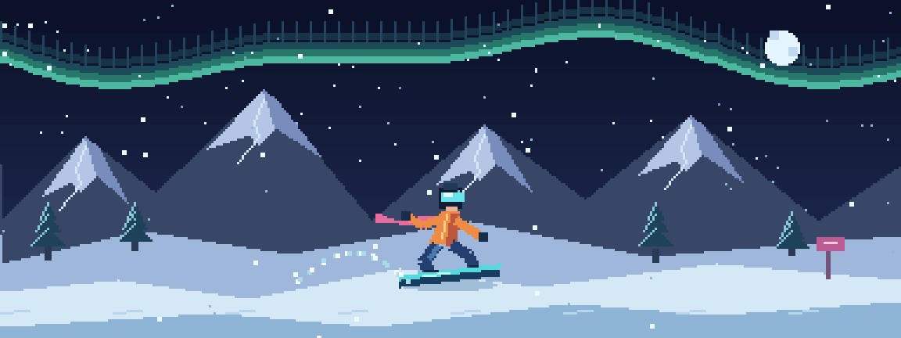

<h1>Marcos Michaliszyn</h1>

<strong>Software · Automação · Inteligência Artificial</strong> 
Software · Automation · Artificial Intelligence

Não apenas acompanhando o futuro, mas aprendendo a construí-lo. 
<em>Not just following the future, but learning to build it.</em>

---

## Sobre mim · About me

Sou Marcos. Gosto de criar ferramentas, explorar inteligência artificial e transformar ideias em experiências que posso testar e melhorar.

Meus projetos passam por assistentes para Windows, automação, experimentos com modelos locais e desenvolvimento de jogos. Também exploro desenvolvimento web, dados e indicadores com SQL, Excel e Power BI. Compartilho aqui o que estou construindo e aprendendo.

**EN** · I'm Marcos. I enjoy building tools, exploring AI, and turning ideas into experiences I can test and improve. My projects span Windows assistants, automation, local AI experiments, and game development. I also explore web development, data, and reporting with SQL, Excel, and Power BI.

 

---

## Tecnologias e ferramentas · Tools & technologies

 

---

## Atividade e código · Activity & code

Atividade no GitHub, horários dos commits (UTC−3) e distribuição das linguagens. Os gráficos refletem os repositórios públicos, não as habilidades ou projetos que ainda estão locais. GitHub activity, commit hours (UTC−3), and language distribution. Charts reflect public repositories, not skills or projects that are still local.

---

## Projetos · Projects

### Destaques · Featured projects

| Projeto / Project | O que você encontra / What you'll find |
| :--- | :--- |
| **[Gemma Blender Studio](https://github.com/Michaliszyn01/gemma-blender-studio)** | Laboratório de modelagem 3D com Ollama e Blender, operações validadas e aprovação humana. / Experimental local AI modeling workflow. |
| **[OrionWorld](https://github.com/Michaliszyn01/orionworld)** | Agentes em ambiente isolado, memória persistente e auditoria. / Sandboxed agents with persistent memory and audit trails. |
| **[Nexus ME](https://github.com/Michaliszyn01/nexus-me)** | Memória de projetos com fontes, interface desktop e IA opcional. / Source-backed project memory with a desktop UI. |
| **[Condution Time](https://github.com/Michaliszyn01/condution-time)** | Rotina, saúde e produtividade com Flask e SQLite. / Local routine and productivity tracking. |
| **[Routine IA](https://github.com/Michaliszyn01/routine-ia)** | Planejamento, foco e revisão espaçada para estudos. / Study planning, focus sessions and spaced reviews. |
| **[Atendente Simples](https://github.com/Michaliszyn01/projeto-atendente-simples)** | Atendimento e agendamento com regras determinísticas. / Rule-driven customer service and scheduling. |

### Outros experimentos · More experiments

[Orion-XT](https://github.com/Michaliszyn01/Orion-XT) · [Multiagent Lab](https://github.com/Michaliszyn01/multiagent-lab) · [Michaliszyn System — site](https://github.com/Michaliszyn01/michaliszyn-system-site) · [Python Task Manager](https://github.com/Michaliszyn01/python-task-manager)

Os repositórios incluem o estágio e as limitações de cada projeto. Dados pessoais, chaves, bancos de trabalho e históricos não fazem parte das publicações. Build a Bot, LifeSim e Atendente IA permanecem privados. 
<em>Repositories document their current stage and limitations. Personal data, credentials, working databases and histories are excluded. Build a Bot, LifeSim and Atendente IA remain private.</em>

---

### Conecte-se · Connect

Criar. Testar. Aprender. Repetir. Build. Test. Learn. Repeat.

