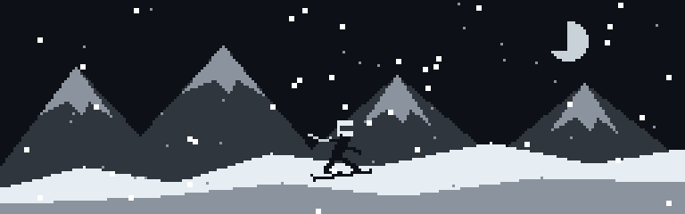

<h1>Marcos Michaliszyn</h1>

<strong>Software · Automação · Inteligência Artificial</strong> 
Software · Automation · Artificial Intelligence

Transformando ideias em projetos, uma evolução por vez. 
<em>Turning ideas into projects, one improvement at a time.</em>

---

## Sobre mim · About me

Sou Marcos. Gosto de criar ferramentas, explorar inteligência artificial e transformar ideias em experiências que posso testar e melhorar.

Meus projetos passam por assistentes para Windows, automação, experimentos com modelos locais e desenvolvimento de jogos. Compartilho aqui o que estou construindo e aprendendo.

**EN** · I'm Marcos. I enjoy building tools, exploring AI, and turning ideas into experiences I can test and improve. My projects span Windows assistants, automation, local AI experiments, and game development.

 

---

## Tecnologias e ferramentas · Tools & technologies

 

 

Ferramentas presentes nos meus projetos e estudos. Sempre aprendendo. 
<em>Tools used in my projects and experiments. Always learning.</em>

---

## GitHub em números · GitHub analytics

Dados dos repositórios públicos. Os gráficos podem levar um tempo para refletir novas publicações. Public repository data. Charts may take time to reflect new activity.

---

## Projetos · Projects

### [Orion-XT](https://github.com/Michaliszyn01/Orion-XT)
Assistente virtual para o computador. 
<em>A virtual assistant for the desktop.</em>

### Em desenvolvimento · Work in progress

| Projeto / Project | O que estou explorando / What I'm exploring |
| :--- | :--- |
| **Build a Bot** | Desenvolvimento de um jogo no Roblox. / Building a Roblox game. |
| **Gemma Blender Studio** | Experimentos com modelos locais e Blender. / Experiments with local AI models and Blender. |
| **LifeSim** | Simulação com inteligência artificial. / AI simulation experiments. |

Os projetos em desenvolvimento serão vinculados aqui conforme seus repositórios forem publicados. 
<em>Work-in-progress projects will be linked here as their repositories are published.</em>

---

### Conecte-se · Connect

Criar. Testar. Aprender. Repetir. Build. Test. Learn. Repeat.

